# Modelo de dados

PostgreSQL 17 · extensões `ltree`, `pg_trgm` · migrations em [`migrations/`](../../migrations/)

| Migration | Conteúdo |
|---|---|
| `Version20261126000000` | extensões |
| `Version20261126000100` | tabelas, PKs, FKs, índices (compatível com o mapeamento Doctrine) |
| `Version20261126000200` | triggers ltree, índices GiST/GIN, seeds (`root`, tipos de ativo) |
| `Version20261126160000` | `raw_inventory.outcome/changes` (+ backfill), tabela `app_setting` |
| `Version20261126170000` | fornecedores, contatos, contratos, licenças, anexos, patrimônio sequencial (ADR-0009) |

## Diagrama ER

```mermaid
erDiagram
    organization ||--o{ organization : parent
    organization ||--o{ location : ""
    location ||--o{ location : parent
    organization ||--o{ asset : ""
    organization ||--o{ app_group : ""
    organization ||--o{ vlan : ""
    app_user }o--o{ app_group : user_group
    app_account ||--o{ user_session : ""
    app_account ||--o{ auth_event : ""
    asset_type ||--o{ asset : ""
    asset_type ||--o{ asset_model : ""
    manufacturer ||--o{ asset_model : ""
    manufacturer ||--o{ asset : ""
    manufacturer ||--o{ component : ""
    manufacturer ||--o{ software : publisher
    asset_model ||--o{ asset : ""
    location ||--o{ asset : ""
    branch ||--o{ asset : ""
    app_user ||--o{ asset : "user"
    app_group ||--o{ asset : "tech_group"
    asset ||--o{ component : ""
    asset ||--o{ network_port : ""
    network_port ||--o{ ip_address : ""
    network_port }o--o{ vlan : network_port_vlan
    software ||--o{ software_version : ""
    software_version ||--o{ software_installation : ""
    asset ||--o{ software_installation : ""
    asset ||--o{ asset_history : ""
    asset ||--o{ locked_field : ""
    agent }o--|| asset : ""
    agent ||--o{ raw_inventory : ""
    raw_inventory }o--|| asset : ""
    branch ||--o{ network_scan : ""
    network_scan ||--o{ network_scan_host : ""
    network_scan_host }o--o| asset : "correlação"
    scan_schedule ||--o{ network_scan : "dispara"
    scan_schedule ||--o{ network_alert : ""
    network_scan ||--o{ network_alert : ""
    network_alert }o--o| asset : ""
    network_alert }o--o| branch : ""
    asset_type ||--o{ stock_item : "patrimônio"
    supplier ||--o{ invoice : ""
    invoice ||--o{ invoice_item : ""
    stock_item ||--o{ invoice_item : ""
    stock_item ||--o{ stock_movement : "razão"
    invoice_item ||--o{ stock_movement : "entrada"
    stock_movement }o--o| branch : "saída"
    stock_movement }o--o| asset : "unidade"
    app_account ||--o{ audit_log : ""
    branch ||--o{ location : "locais (ADR-0016)"
    location ||--o{ dcim_rack : ""
    branch ||--o{ dcim_rack : ""
    dcim_rack ||--o{ dcim_device : "U/face"
    location ||--o{ dcim_device : ""
    dcim_device_type ||--o{ dcim_port_template : "modelo de portas"
    dcim_device_type ||--o{ dcim_device : ""
    dcim_device_role ||--o{ dcim_device : ""
    asset |o--o| dcim_device : "vínculo opcional"
    dcim_device ||--o{ dcim_port : "portas"
    dcim_port ||--o{ dcim_port_mapping : "frontal↔traseira"
    dcim_cable ||--|{ dcim_cable_termination : "pontas A/B"
    dcim_port |o--o| dcim_cable_termination : ""
    circuit_termination |o--o| dcim_cable_termination : ""
    supplier ||--o{ circuit : "operadora"
    circuit ||--o{ circuit_termination : "lados A/Z"
    ipam_vrf ||--o{ ipam_prefix : ""
    ipam_vrf ||--o{ ipam_ip_address : ""
    ipam_vlan ||--o{ ipam_prefix : ""
    ipam_vlan_group ||--o{ ipam_vlan : ""
    dcim_port ||--o{ ipam_ip_address : "IP na interface"
    dcim_port }o--o{ ipam_vlan : "tagged"
    virt_cluster_type ||--o{ virt_cluster : "plataforma"
    virt_cluster_group ||--o{ virt_cluster : ""
    virt_cluster ||--o{ dcim_device : "hosts"
    virt_cluster ||--o{ virt_machine : ""
    dcim_device ||--o{ virt_machine : "roda em"
    asset |o--o| virt_machine : "vínculo opcional"
    virt_machine ||--o{ virt_interface : ""
    virt_machine ||--o{ virt_disk : ""
    virt_interface ||--o{ ipam_ip_address : "IP da VM"
    virt_interface }o--o{ ipam_vlan : "tagged"
    unifi_controller ||--o{ unifi_site : ""
    branch |o--o{ unifi_site : "vínculo opcional"
    unifi_site ||--o{ unifi_wlan : "redes Wi-Fi"
    mac_identity ||--o{ mac_wlan_assignment : ""
    unifi_wlan ||--o{ mac_wlan_assignment : "filtro de MAC"
    app_user |o--o{ mac_identity : "pessoa"
    asset |o--o{ mac_identity : "patrimônio"
```



## Dicionário

### Organização e identidade

| Tabela | Descrição | Pontos de atenção |
|---|---|---|
| `organization` | unidade organizacional (a "Entidade" do GLPI) | `code` único e estável; `path` ltree via trigger |
| `location` | localização física hierárquica (setor/sala; texto livre no formulário) | `UNIQUE (organization_id, parent_id, name)`; `path` ltree |
| `branch` | **matriz e filiais** (ADR-0010): CNPJ, endereço estruturado, `latitude`/`longitude` `NUMERIC(9,6)`, `networks` JSONB (CIDRs) | nome e sigla únicos; no máximo uma `headquarters` (regra no `BranchWriter`); CHECKs de `kind`, UF, par de coordenadas e `networks` array |
| `app_user` | pessoas (usuário do ativo, responsável) | `username` minúsculo e único; `auth_source` local/ldap/oidc |
| `app_group` | grupos responsáveis | `UNIQUE (organization_id, name)` |
| `user_group` | N:N usuário ↔ grupo | PK composta |
| `app_account` | **contas de acesso ao painel** (ADR-0011): login, perfil `admin`/`editor`/`viewer`, `password_hash` Argon2id, `totp_secret` cifrado | CHECKs de perfil, formato do login e hash `$argon2id$`; separada de `app_user` |
| `user_session` | sessões do painel: SHA-256 do token, `state` `active`/`mfa_pending`, IP, user-agent, inatividade/expiração/revogação | apagadas 7 dias após expirar/revogar |
| `auth_event` | auditoria de acesso (login, falhas, bloqueios, 2FA, ações de admin); base do bloqueio por tentativas | append-only; retenção 365 dias; índices por (username, data) e (ip, data) |

### Ativos

| Tabela | Descrição | Pontos de atenção |
|---|---|---|
| `asset_type` | tipos (computer, network_equipment, printer...) | seed na migration; `inventoriable` = recebe agente |
| `manufacturer` | fabricantes e editores | dedup por `normalized_name` |
| `asset_model` | modelo comercial | `UNIQUE (asset_type_id, manufacturer_id, name)` |
| `asset` | **o ativo** (tabela única, ver ADR-0003) | `uuid` público (v7); `hardware_uuid`/`serial_number` = chaves de matching; `attributes` JSONB+GIN; `deleted_at` = lixeira (o agente voltando a reportar **restaura** o mesmo ativo); `branch_id` = filial (SET NULL; preenchida pela rede quando vazia); `os_*` = SO embutido |
| `component` | CPU, RAM, disco, GPU... | `kind` enum; `capacity_mib`/`frequency_mhz`; `dynamic` = veio do agente |
| `locked_field` | campos que o inventário não sobrescreve | `asset_id NULL` = trava global |
| `asset_history` | auditoria por campo (append-only) | maior crescimento; ver Manutenção |

### Software

| Tabela | Descrição | Pontos de atenção |
|---|---|---|
| `software` | catálogo | dedup por `normalized_key` = nome + editor |
| `software_version` | versão + arquitetura | `''` em vez de NULL, para a UNIQUE funcionar |
| `software_installation` | software instalado no ativo | `UNIQUE (asset_id, software_version_id)`; ~300–1500 linhas por estação Windows |

### Rede

| Tabela | Descrição | Pontos de atenção |
|---|---|---|
| `network_port` | NIC / porta de switch | MAC normalizado `aa:bb:..`; `if_index` p/ SNMP (fase 2) |
| `ip_address` | IPs da porta | texto canônico (`inet_ntop`) + `prefix_length`; fase 2: tipo `inet` |
| `vlan` | VLAN 802.1Q | `UNIQUE (organization_id, tag)` |
| `network_port_vlan` | N:N porta ↔ VLAN | |

### Gestão (ADR-0009)

| Tabela | Descrição | Pontos de atenção |
|---|---|---|
| `supplier` / `contact` | fornecedor (CNPJ único) e pessoas de contato | contato some com o fornecedor (CASCADE) |
| `contract_type` / `contract` | tipo editável; vigência, renovação, aviso, periodicidade, valor `NUMERIC(14,2)` | status calculado: `open`/`active`/`expiring`/`expired` |
| `contract_asset` | N:N contrato ↔ ativo | |
| `license_type` / `license_category` | cadastros editáveis; tipo define o modelo padrão (`device`/`user`/`volume`) | tipo em uso não pode ser excluído (RESTRICT) |
| `license` | assentos, valor unitário, vencimento, `software_match`, `license_key` **cifrada** | CHECK de modelo e assentos ≥ 0 |
| `license_assignment` | assento consumido por ativo **ou** usuário | CHECK `chk_license_assignment_target`; UNIQUE por (licença, alvo) |
| `attachment` | fotos/documentos de ativo, contrato, fornecedor, licença | binário em `ATTACHMENTS_DIR`; `sha256` para integridade |
| `asset_inventory_seq` | sequência do patrimônio automático | fora do schema diff (`schema_filter`) |

### Inventário

| Tabela | Descrição | Pontos de atenção |
|---|---|---|
| `agent` | GLPI Agent que contatou | `device_id` único; `last_contact_at` indexado |
| `raw_inventory` | payload recebido (JSONB) | `status` received/processing/processed/failed/rejected; `outcome` created/updated/unchanged + `changes`; `duration_ms` |
| `app_setting` | configurações editáveis no painel (chave → JSONB) | ver `App\Settings\Service\Settings::DEFINITIONS` |
| `messenger_messages` | fila "failed" do Messenger | criada por `messenger:setup-transports`; fora do schema diff |

### Ferramentas (ADR-0012)

| Tabela | Descrição | Pontos de atenção |
|---|---|---|
| `network_scan` | varredura: alvo CIDR, perfil, `status` queued/running/done/failed/cancelled, `phase`/`progress`, `options` (privilegiado, versão do nmap, avisos), quem pediu | CHECK de status/perfil/progresso; filial `SET NULL`; **community SNMP nunca é gravada** |
| `scan_schedule` | varredura agendada (ADR-0013): alvo, perfil, `frequency` interval/daily, `interval_hours`/`run_at`/`weekdays`, `alerts` (JSONB de flags), `next_run_at` | CHECK de frequência/horário; `snmp_community` **cifrada** (SecretBox); excluir mantém o histórico (`network_scan.schedule_id` → NULL) |
| `network_alert` | alerta de rede: `kind` (new_device, mac_changed, ip_conflict, new_ports, device_gone, scan_failed, baseline), `severity`, `fingerprint` (SHA-256 tipo+chave), `occurrences`, reconhecimento | deduplica por fingerprint enquanto aberto (em código, sem índice parcial — ver ADR); FKs `SET NULL`; reconhecidos > 180 dias são apagados pelo tick |
| `notification_channel` | canal de notificação: teams/telegram/slack/webhook, `min_severity`, último status | `target` (URL/token) **cifrado**; só admin |
| `network_scan_host` | host encontrado: IP, MAC + origem (`arp`/`snmp`/`netbios`), fabricante, nomes, SO, `device_type`, portas e detalhes (JSONB), `asset_id` + `match_by` | UNIQUE `(scan_id, ip)` para upsert em streaming; some com a varredura (CASCADE); ativo excluído → `SET NULL` |

### Auditoria (ADR-0015)

| Tabela | Descrição | Pontos de atenção |
|---|---|---|
| `audit_log` | uma linha por ação bem-sucedida na interface: `actor`, `ip`, `action` (`invoice.deleted`, `stock.out`…), `module`, `method`/`path`, `entity_type`/`entity_id`, `subject` (descrição legível, lida antes da ação), `status`, `details` (JSONB: corpo sem segredos + ids devolvidos) | **somente inclusão**: trigger `trg_audit_log_guard` (função `audit_log_guard()`) bloqueia UPDATE/DELETE, exceto o `SET NULL` de `account_id` ao excluir a conta; sem retenção automática; índices por data, objeto, usuário e ação |

### Estoque e notas fiscais (ADR-0014)

| Tabela | Descrição | Pontos de atenção |
|---|---|---|
| `stock_item` | item do estoque central: nome (único), categoria, `tracked` (patrimônio por unidade) + `asset_type_id`, `min_quantity`, `active` | CHECK `tracked → asset_type_id`; com histórico não se exclui (só desativa, com saldo zero) nem troca `tracked` |
| `invoice` | nota fiscal simplificada: fornecedor, `number` (sem zeros à esquerda), `series`, `issue_date`, `total` informado, `status` registered/sent + data/autor do envio ao lançamento | UNIQUE `(supplier_id, number, series)`; fornecedor `RESTRICT`; anexos com `owner_type = invoice` |
| `invoice_item` | linha da nota: item, `quantity` > 0, `unit_price` ≥ 0, `position` | CASCADE com a nota; item `RESTRICT`; não editável depois de salvo |
| `stock_movement` | razão do estoque: `kind` in/out/adjust, `quantity` com sinal, `unit_cost`, `batch` (operação), filial (saída), ativo (unidade com patrimônio), `recipient` (A/C), `department` (setor — etiqueta de envio), `reason`, `actor`, `occurred_at` | **saldo = SUM(quantity)**; CHECK de sinal por tipo; entrada some com a nota (CASCADE via `invoice_item`); operações travam `stock_item` FOR UPDATE |

### Infraestrutura: DCIM, cabeamento, circuitos e IPAM (ADR-0016)

| Tabela | Descrição | Pontos de atenção |
|---|---|---|
| `location` (+colunas) | `branch_id` (filial), `kind` (building/floor/room/datacenter/workstation/other), `description` | filho herda a filial (serviço); trocar filial bloqueado se há rack/equipamento na subárvore |
| `dcim_device_role` | função do equipamento com cor hex e `icon` (desenho no mapa — ADR-0018) | seed: Switch, Patch panel, Ponto de rede, DIO, PDU…; exclusão bloqueada se usada por equipamento ou VM |
| `attachment` (+) / `raw_inventory` (+) | `encryption_key` (chave do arquivo cifrada — ADR-0019); `payload_sealed` (inventário cifrado) e `payload_legacy` (JSONB antigo, esvaziado por `app:crypto:rotate`) | |
| `dcim_platform` | lista editável de sistemas operacionais/plataformas (ADR-0018) | UNIQUE nome; renomear propaga para `virt_machine.platform` (texto); exclusão bloqueada se em uso |
| `dcim_device_type` | fabricante (`manufacturer`) + modelo, `u_height` (passo 0,5), `is_full_depth`, função padrão | UNIQUE `(manufacturer_id, model)`; anexos `device_type` (foto do modelo) |
| `dcim_port_template` | portas do modelo: `kind`, nome, tipo físico, `positions` (traseira), `rear_port_template_id` + `rear_position` (frontal) | instanciadas ao criar o equipamento |
| `dcim_rack` | rack: filial, local, `u_height`, `width`, `starting_unit`, `desc_units`, status | UNIQUE `(branch_id, name)`; equipamento `RESTRICT` |
| `dcim_device` | equipamento: filial/local/rack, `position` (U) + `face`, tipo, função, status, série, patrimônio, `asset_id` (UNIQUE, SET NULL), `primary_ip_id` | CHECK posição ⇒ rack + face; sobreposição de U validada no serviço com `FOR UPDATE` no rack |
| `dcim_port` | **uma tabela para as 7 portas do NetBox**: `kind` interface/front/rear/console/console_server/power_port/power_outlet; MAC, modo 802.1Q, VLAN nativa, `positions`, consumo W, `mark_connected` | UNIQUE `(device_id, kind, name)`; `positions > 1` só em traseira |
| `dcim_port_vlan` | VLANs tagged da interface | |
| `dcim_port_mapping` | frontal (posição) ↔ traseira (posição) | UNIQUE em cada lado |
| `dcim_cable` | cabo: etiqueta, tipo, status connected/planned/decommissioning, cor, comprimento + unidade | anexos `cable` (certificação) |
| `dcim_cable_termination` | ponta A/B do cabo em **porta ou terminação de circuito** (FK real) | CHECK `num_nonnulls = 1`; UNIQUE por porta/terminação → no máximo um cabo; CASCADE |
| `circuit_type` / `circuit` | circuito de operadora: `supplier_id` (operadora), tipo, `cid`, status, banda (kbps), datas, contrato | UNIQUE `(supplier_id, cid)` |
| `circuit_termination` | lado A/Z: filial/local **ou** `provider_network`, cross-connect, entrega, velocidades | UNIQUE `(circuit_id, term_side)` |
| `ipam_vrf` | VRF, RD, `enforce_unique` | |
| `ipam_prefix` | `prefix CIDR`, VRF, filial, local, VLAN, status (container/active/reserved/deprecated), papel, `is_pool`, `mark_utilized` | hierarquia por contenção (`<<`), índice GiST `inet_ops`; duplicado recusado no serviço |
| `ipam_ip_range` | faixa `start_address`–`end_address` (INET com máscara), status, papel, `mark_utilized` | CHECK mesma família/máscara e início ≤ fim; sobreposição recusada no serviço |
| `ipam_ip_address` | `address INET` com máscara, VRF, `port_id` (interface), status, papel, DNS | GiST `inet_ops`; unicidade por VRF no serviço sob `pg_advisory_xact_lock` |
| `ipam_vlan_group` / `ipam_vlan` | grupo com faixa de VID; VLAN (VID 1–4094, único no grupo) | não confundir com `vlan` (VLANs vistas pelo agente) |

### Virtualização (ADR-0017)

| Tabela | Conteúdo | Regras |
|---|---|---|
| `virt_cluster_type` / `virt_cluster_group` | plataforma (seed: Proxmox VE, VMware ESXi/vSphere, Hyper-V, XCP-ng, KVM, Nutanix AHV) e agrupamento livre | exclusão bloqueada se em uso |
| `virt_cluster` | cluster/virtualizador: tipo, grupo, filial, status, versão, `management_url` | UNIQUE nome; anexos `cluster` |
| `dcim_device` (+) | `cluster_id` (host do cluster), `cpu_threads`, `memory_mb`, `storage_gb` | capacidade nula = lida do inventário (componentes `processor`/`memory`/`storage`, `memory_mib`) |
| `virt_machine` | VM: cluster, `device_id` (host), função, `asset_id` (UNIQUE, SET NULL), `vcpus NUMERIC(6,2)`, `memory_mb`, `disk_gb`, `vmid`, SO, `primary_ip_id` | UNIQUE `(cluster_id, name)`; host precisa estar no cluster (serviço); anexos `vm` |
| `virt_interface` / `virt_interface_vlan` | NIC da VM: bridge, MAC, MTU, modo 802.1Q, VLAN nativa / tagged | UNIQUE `(vm_id, name)`; CASCADE |
| `virt_disk` | disco virtual: nome, `size_gb`, storage | UNIQUE `(vm_id, name)`; soma vira `virt_machine.disk_gb` |
| `ipam_ip_address` (+) | `vm_interface_id` | CHECK: não pode ter `port_id` **e** `vm_interface_id` |

### Wi-Fi / UniFi — identidade de MAC (ADR-0020)

| Tabela | Conteúdo | Regras |
|---|---|---|
| `unifi_controller` | controller UniFi Network: `base_url`, `auth_mode` (`local`/`api_key`/`cloud`), `username`, `secret` (**cifrado**, contexto `unifi.secret:<id>`), `verify_tls`, `tls_pin` (pin-sha256 SPKI), `platform`, `version`, `write_client_alias`, `last_sync_at`, `last_error` | UNIQUE nome; CHECK `auth_mode`; segredo entra no `app:crypto:rotate` |
| `unifi_site` | site do controller: `site_ref` (o `e6ovl2sz` da URL), `external_id`, `description`, `branch_id`, `present` | UNIQUE `(controller_id, site_ref)`; sumiu do UniFi → `present = false` |
| `unifi_wlan` | rede Wi-Fi: `external_id` (`_id` do wlanconf), nome, segurança, `filter_enabled`, `filter_policy` (`allow`/`deny`), `remote_macs` JSONB (lista lida do UniFi), `present` | UNIQUE `(site_id, external_id)`; a senha do Wi-Fi **nunca** é gravada |
| `mac_identity` | MAC normalizado (`aa:bb:cc:dd:ee:ff`), pessoa (nome, matrícula, setor, e-mail, telefone, `person_id`), aparelho (tipo, marca, modelo, hostname, `asset_id`), `branch_id`, `valid_until`, `status` (`active`/`revoked`), `source` (`panel`/`imported`) | UNIQUE `mac`; CHECK formato do MAC, `status`, `source`; índice `(status, valid_until)` para o vencimento |
| `mac_wlan_assignment` | MAC × rede: `state` (`pending`/`synced`/`error`/`removing`), `last_error`, `synced_at` | UNIQUE `(identity_id, wlan_id)`; CASCADE dos dois lados; índice `(wlan_id, state)` |

## Objetos fora do ORM

| Objeto | Onde | Por quê |
|---|---|---|
| `app_tree_path()` + `trg_*_path` | 000200 | calcula `path` a partir de `parent_id` e bloqueia ciclos |
| `app_tree_path_cascade()` + `trg_*_path_cascade` | 000200 | reescreve a subárvore ao mudar de pai |
| `gist_organization_path`, `gist_location_path` | 000200 | operadores `<@`, `@>`, `~` |
| `gin_asset_attributes` (`jsonb_path_ops`) | 000200 | filtros `attributes @> '{...}'` |
| `gin_asset_name_trgm`, `gin_software_name_trgm` | 000200 | `ILIKE '%termo%'` indexado (busca da UI/API) |
| `chk_branch_*` | 180000 | `kind`, UF `^[A-Z]{2}$`, coordenadas em par e na faixa, `networks` é array |

Esses índices são registrados em `src/Shared/Doctrine/SchemaExtrasListener.php`; sem isso, o `make diff` tentaria removê-los.
- `audit_log_guard()` + trigger `trg_audit_log_guard` (BEFORE UPDATE OR DELETE em `audit_log`): trilha somente inclusão (ADR-0015).

## Consultas úteis

```sql
-- saldo, mínimo e quanto comprar por item (estoque central)
SELECT i.name, i.category, coalesce(sum(m.quantity), 0) AS saldo, i.min_quantity,
       greatest(i.min_quantity - coalesce(sum(m.quantity), 0), 0) AS comprar
FROM stock_item i LEFT JOIN stock_movement m ON m.stock_item_id = i.id
WHERE i.active GROUP BY i.id ORDER BY comprar DESC, i.name;

-- notas ainda não enviadas ao setor de lançamento
SELECT n.number, s.name AS fornecedor, n.issue_date, n.total FROM invoice n JOIN supplier s ON s.id = n.supplier_id
WHERE n.status = 'registered' ORDER BY n.issue_date;
```


```sql
-- Subárvore de uma organização
SELECT o.code, o.path FROM organization o
WHERE o.path <@ (SELECT path FROM organization WHERE code = 'filial-sp');

-- De quem é este MAC?
SELECT a.name, a.serial_number, p.name AS iface
FROM network_port p JOIN asset a ON a.id = p.asset_id
WHERE p.mac_address = 'b0:26:28:aa:bb:01';

-- Ativos sem inventário há mais de 30 dias
SELECT name, last_inventory_at FROM asset
WHERE dynamic AND deleted_at IS NULL AND last_inventory_at < now() - interval '30 days'
ORDER BY last_inventory_at;

-- Versões de um software instaladas no parque
SELECT sv.version, count(*) FROM software s
JOIN software_version sv ON sv.software_id = s.id
JOIN software_installation si ON si.software_version_id = sv.id
WHERE s.name ILIKE '%openssh%' GROUP BY 1 ORDER BY 2 DESC;

-- Ativos por filial e tipo (painel Grafana)
SELECT coalesce(b.name, '(sem filial)') AS filial, t.label AS tipo, count(*)
FROM asset a JOIN asset_type t ON t.id = a.asset_type_id LEFT JOIN branch b ON b.id = a.branch_id
WHERE a.deleted_at IS NULL GROUP BY 1, 2 ORDER BY 1, 3 DESC;

-- Em qual filial cai este IP? (mesma regra do BranchResolver)
SELECT b.name, n.cidr FROM branch b, jsonb_array_elements_text(b.networks) n(cidr)
WHERE b.active AND '10.20.5.33'::inet <<= n.cidr::cidr ORDER BY masklen(n.cidr::cidr) DESC LIMIT 1;

-- Saúde da ingestão (painel Grafana)
SELECT date_trunc('hour', received_at) h, status, count(*), avg(duration_ms)::int ms
FROM raw_inventory WHERE received_at > now() - interval '24 hours'
GROUP BY 1, 2 ORDER BY 1;
```

## Manutenção

- **Backup:** `pg_dump -Fc bianchi` diário + backup do CT no PBS. Teste o restore mensalmente.
- **`asset_history`:** acima de ~50M linhas, particionar por `RANGE (created_at)` mensal
  (migration dedicada + `pg_partman` exige ADR).
- **`raw_inventory`:** o payload ocupa espaço (TOAST com `lz4`). Fase 2: limpeza mantendo os N
  últimos por `device_id`. Paliativo:
  `DELETE FROM raw_inventory WHERE status='processed' AND received_at < now()-interval '30 days';`
- **Autovacuum:** as tabelas `software_installation` e `component` têm muito churn. Monitore
  `pg_stat_user_tables.n_dead_tup` pelo Zabbix (template PostgreSQL by Zabbix agent 2).
